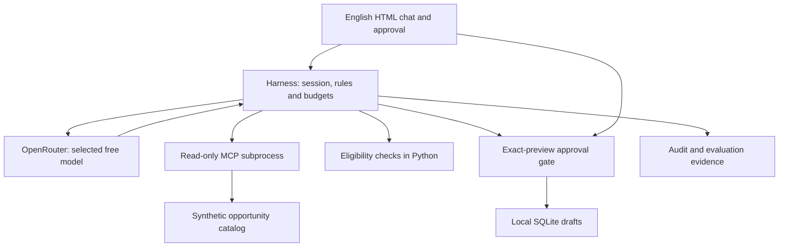

# Architecture

One agent selects tools. The host binds identity, enforces four schemas and owns all writes. Search and detail retrieval cross a real SDK stdio MCP boundary. The catalog subprocess cannot approve or save a draft. Academic details are editable through the optional browser panel or direct CLI commands; model tools have no profile/identity mutation capability.

Each request can complete, ask for missing information, stop on a budget, fail on a provider error, or return a permission/eligibility denial. No graph or multi-agent coordinator is needed for this bounded task. SQLite stores drafts, not the conversation; session memory is in-process.

Normal chat begins at `You:` without a profile or form. The model obtains search preferences from the message and follow-up context. Field AI does not establish a major. Academic forms are optional advanced eligibility/draft inputs and never a prerequisite for browsing.

The final JSON keeps browsing candidates in `answer`; `opportunity_ids` is an eligible shortlist, not an index of every mentioned ID. The host independently rejects unknown or ineligible shortlist entries and permits at most one model repair inside the original budgets. It does not silently edit the answer. This safeguard checks the structured shortlist; prose still requires evaluation and human review.

The local Starlette server serves the HTML/CSS/JavaScript and JSON endpoints on loopback. Every browser conversation owns one worker task, one real MCP client and an isolated draft database. Keeping MCP entry/exit in the same worker preserves its structured concurrency. During an approval, the worker waits for one expiring, preview-bound browser decision; further messages and academic changes are rejected until the turn finishes. The API key remains in the Python process. The browser never receives it.
